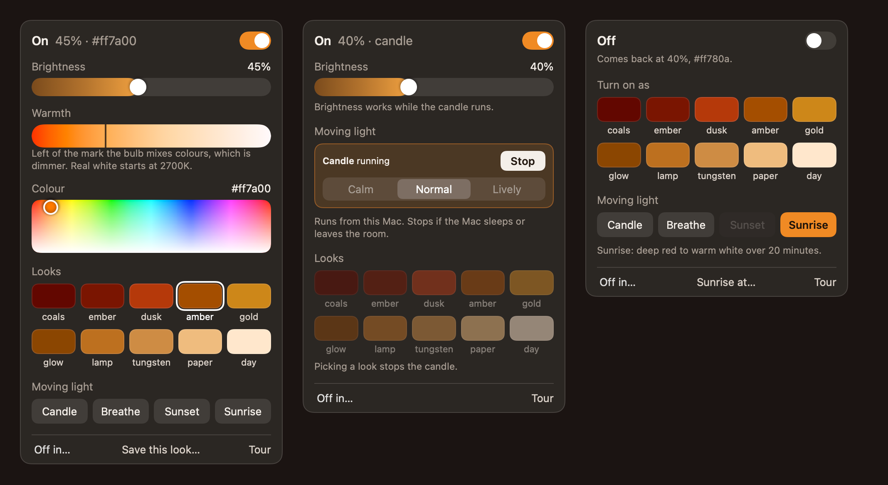
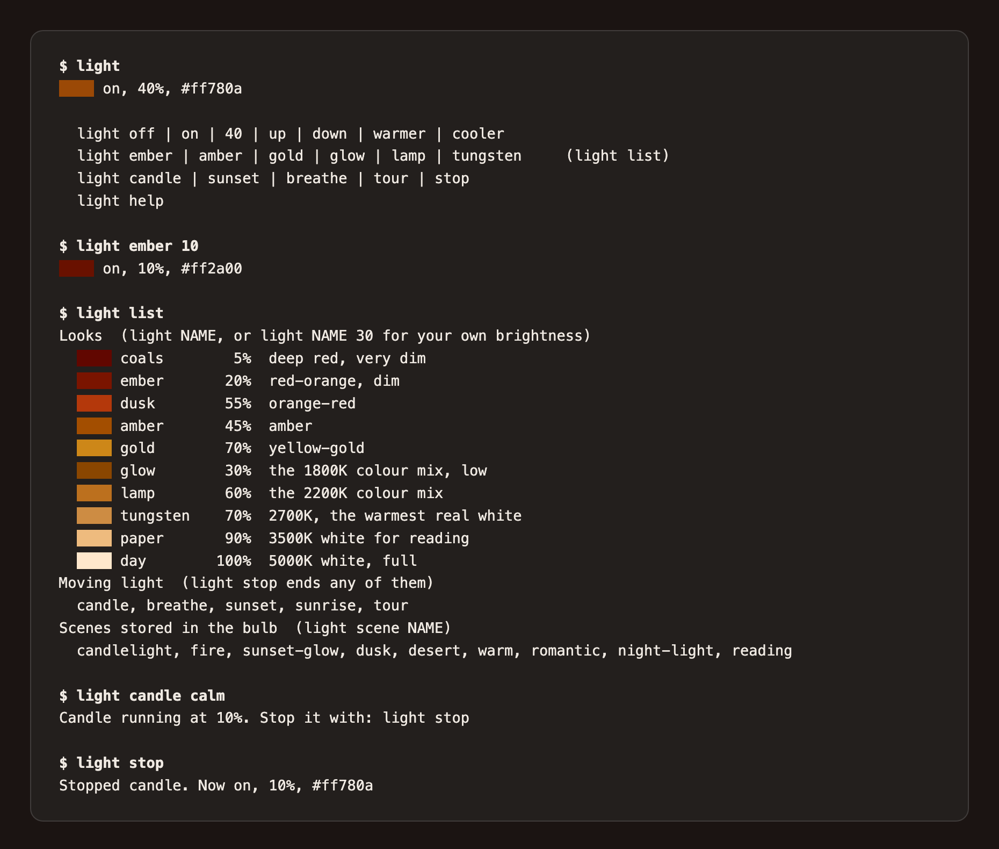

# light

Control a Govee H6008 bulb from the macOS terminal and menu bar, over local Bluetooth. It uses no Govee account, no cloud and no Wi-Fi.





## The bulb

Govee Smart LED Bulb, model H6008: an 800 lumen colour and white bulb with Wi-Fi and Bluetooth. Govee sells it per region, with the screw or bayonet base that region uses:

- [United States, E26](https://us.govee.com/products/govee-wi-fi-bluetooth-led-bulbs-2-pack)
- [Europe, E27](https://eu.govee.com/products/govee-smart-led-bulb)
- [United Kingdom, B22](https://uk.govee.com/products/govee-smart-led-bulb)

This was built and tested on one H6008. Other Govee models speak different dialects of the protocol and will not work without changes.

## What you can type

```
light                     what the lamp is doing now
light on | off | toggle
light 40                  brightness, 1 to 100
light up | down           a step brighter or dimmer
light warmer | cooler     a step along the warm-to-cool scale
light back                the look before the last change

light amber               a named look; light list shows them all
light ember 10            a named look at your own brightness
light 2000k               colour temperature, 1000 to 6500
light "#ff8800"           any colour
light save reading-nook   save the current look under your own name

light candle              a flame flicker; also: calm, lively, for 45m
light breathe             a breathing pacer: in as it rises, out as it falls
light sunset 30           fade to deep red and off over 30 minutes
light sunrise 20 at 7:00  deep red to warm white, full light at 7:20
light scene candlelight   one of nine animations stored in the bulb
light tour                about a minute through everything, then back to your look
light stop                ends any of these and leaves the lamp steady

light off in 30m          also: light off at 23:30
light pulse ok            two soft gold swells, then back to your look
light pulse fail          two slow red ones

light gui                 open the menu bar panel
light help                the full list
```

A pulse is for scripts: `make test && light pulse ok || light pulse fail`.

## The menu bar panel

`light gui` starts Lamp, a small app that puts a lamp icon in the menu bar. Click the icon, or press Control-Option-Shift-L anywhere, to open the panel. Esc or a click elsewhere closes it.

The panel has the power switch, a brightness slider, a warmth slider, a colour pad for any colour, your looks as swatches, and buttons for Candle, Breathe, Sunset and Sunrise. The lamp follows the sliders and the colour pad as you drag. While a mode runs, the panel shows what is running, when it ends, and Stop.

Right-click a saved look to forget it. Right-click the menu bar icon for the scenes stored in the bulb, Open at login, and Quit Lamp. The shortcut works only while Lamp is running, so turn on Open at login if you want it after every restart.

## Install

You need a Mac on macOS 13 or newer, the Xcode Command Line Tools (`xcode-select --install`), and Python 3.11 or newer. `build.sh` looks for Homebrew's Python 3.13 by default; set `LIGHT_PYTHON` to use another.

```
git clone https://github.com/whatgoodarewords/light
cd light
bash build.sh
```

`build.sh` makes a Python environment in `.venv`, builds and signs the two small apps (`Light.app`, the Bluetooth helper, and `Lamp.app`, the menu bar panel), and runs the offline tests.

The tool controls one bulb, the one named at the top of `light.py`. To point it at yours:

```
./light find
```

macOS asks once whether Light may use Bluetooth. `light find` then lists the Govee lights it hears, each with a name such as `GVH6008XXXX` and an identifier. Put your bulb's two values in `NAME` and `ADDRESS` at the top of `light.py`. The identifier belongs to your Mac: the same bulb has a different one on another Mac. If your bulb does not appear, close the Govee app first, since a bulb that is connected to something stops announcing itself.

Then try `./light`. To have `light` everywhere, link it into a folder on your PATH:

```
ln -s "$PWD/light" /opt/homebrew/bin/light
```

## What this bulb can and cannot do

Measured on the bulb:

- Real white runs from 2700K to 6500K. The bulb clamps anything lower to 2700K. Below 2700K, `light` mixes red and green LEDs to imitate the temperature, using the Govee app's own colour table. Those mixes give about a fifth of the light of real white at the same brightness number, and colours of objects look flatter under them. `light warmer` and `light cooler` adjust brightness when they cross 2700K so the room does not jump.
- Any setting wakes the bulb. After a sunset the bulb remembers a faint deep red at 1%; `light on` brings back the look from before the sunset. If you cut power at the wall instead, the lamp comes back as that faint red until the next `light` command.
- Candle, breathe, sunset, sunrise and timers run from the Mac. It has to stay awake and within Bluetooth range. `light` asks macOS not to idle-sleep while one runs, but a closed lid still sleeps. If the lamp stops answering, the mode ends and the next `light status` says so. The nine scenes run inside the bulb.
- While `light` is connected, the Govee app cannot reach the bulb over Bluetooth. `light` lets go 45 seconds after the last command, and at once with `light quit`.

## How it works

| File | Job |
| --- | --- |
| `light` | a wrapper that runs `cli.py` |
| `cli.py` | reads your words and sends one request to the helper |
| `Light.app`, `agent.py` | the helper. macOS grants Bluetooth to an app, so this app owns the permission. It starts on the first command, holds the link so repeat commands answer in well under a second, runs the animations, and exits when idle. |
| `Lamp.app`, `gui/` | the menu bar panel. It sends the same requests as `cli.py` and needs no permissions of its own. |
| `light.py` | the Bluetooth protocol |
| `warm.py` | looks, scenes, colour tables and the flame model |

`light` verifies every lasting change twice: the bulb must acknowledge the command, and a separate state readback must match. Animation frames between two verified states go out unchecked so motion stays smooth.

The helper connects to the bulb by the identifier macOS already knows, without scanning first. In a building full of Bluetooth devices, scanning missed the bulb for up to half a minute at a time.

The H6008 uses a two-step handshake and AES-ECB/RC4 framing with a published vendor constant. It does not use the AES-GCM transport that some newer Govee models use. The protocol reference is [govee-ble-local](https://pypi.org/project/govee-ble-local/1.10.0/) 1.10.0 by Brady Woods (MIT, see `THIRD_PARTY_LICENSE.txt`). The scene data and the Kelvin colour table come from the same package.

## Tests

```
.venv/bin/python -m unittest discover -s tests     offline, about 40 seconds
.venv/bin/python tests/live_check.py               about five minutes on the real lamp
```

The live check runs the real `light` command against the real lamp. It also reads the MacBook's ambient light sensor (a brightness number; no camera is involved) to confirm that the room changed. `verification-v2.txt` records what was verified and what was not.

`v1/` holds the original one-shot version this grew from.

Logs are in `work/agent.log`. Your saved looks are in `presets.json`.
